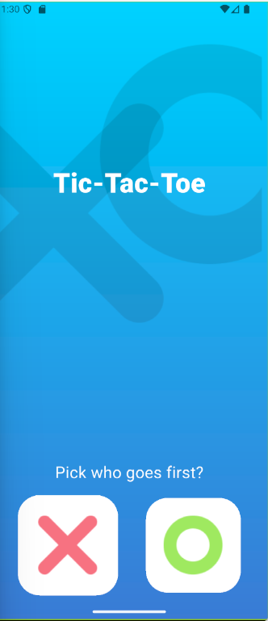
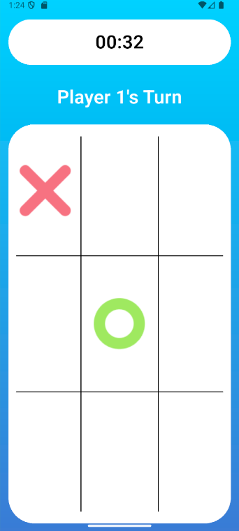

## XO App

XO App is a Flutter Tic-Tac-Toe game where you pick who goes first and play on the same device.

## App Screen

<table> <tr> <td align="center"> Splash Screen</td> <td align="center"> XO Screen</td> </tr> </table>

## Features

- **Splash**
  - Game title with a themed background.
  - "Pick who goes first?" choice between X and O.
- **Game**
  - Tic-Tac-Toe board screen.
  - Reusable X / O button widget.
  - Shared UI
  - Centralized colors, text styles, and constants.

## Architecture

The project follows a simple, organized layout:

lib/
├── screen/
│ ├── xo_splash.dart # Splash screen (choose X or O)
│ └── xo_screen.dart # Game board screen
├── utils/
│ ├── app_colors.dart # App color palette
│ ├── app_constant.dart # Constants (asset paths, etc.)
│ ├── app_scaffold.dart # Shared scaffold widget
│ ├── app_styles.dart # Text styles
│ └── xo_button.dart # Reusable X / O button
└── main.dart # Application entry point

---

# 👨‍💻 Developer

## Mohamed Ayman

**Flutter Developer**

Passionate about building modern, responsive, and scalable Flutter applications.

---
